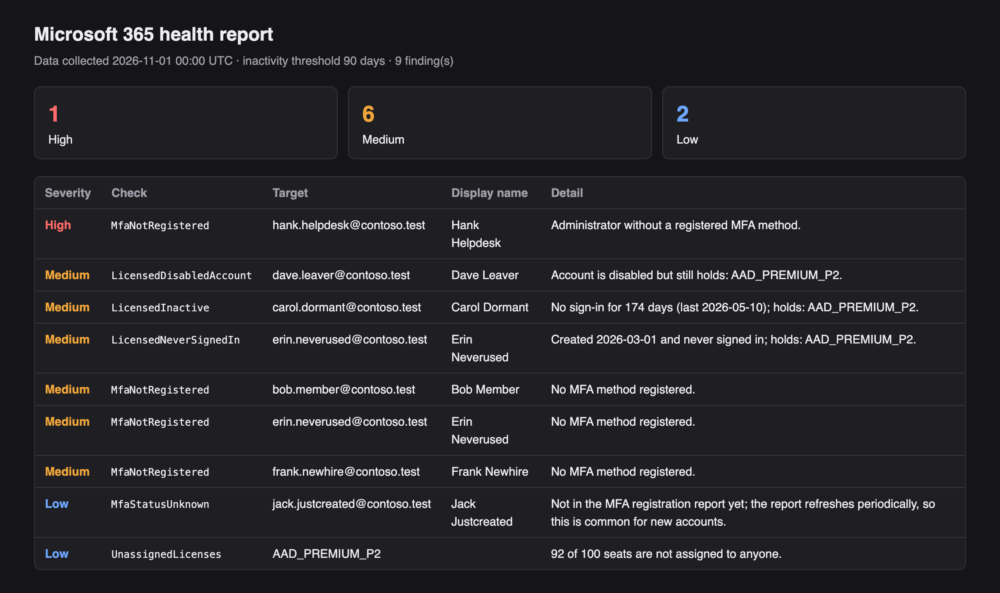

# m365-health-report


A small, read-only PowerShell module that checks a Microsoft 365 / Entra ID tenant over **Microsoft Graph** for two things admins care about every week:

- **Accounts without MFA**, with administrators flagged as high risk
- **Idle licenses**: seats nobody is assigned, disabled accounts still holding a license, and licensed accounts that stopped signing in or never started

It produces a CSV for follow-up and an HTML report for people, and can exit non-zero so a scheduled pipeline can alert on it.



## Checks

| Check | Severity | Finds |
| --- | --- | --- |
| `MfaNotRegistered` | **High** for admins, Medium otherwise | Enabled member accounts with no MFA method registered |
| `MfaStatusUnknown` | Low | Accounts not in the registration report yet (it refreshes periodically, so new accounts lag) |
| `LicensedDisabledAccount` | Medium | Disabled accounts that still hold a license |
| `LicensedInactive` | Medium | Licensed accounts with no sign-in for more than `-InactiveDays` (default 90) |
| `LicensedNeverSignedIn` | Medium | Licensed accounts that never signed in and are older than `-InactiveDays` |
| `UnassignedLicenses` | Low | Purchased seats assigned to nobody, per SKU (free self-service SKUs are ignored) |

## Try it without a tenant

The repository ships a sanitised snapshot of a test tenant, so the report runs anywhere PowerShell 7 does:

```powershell
./run.ps1 -SnapshotPath ./tests/fixtures/snapshot.json
# open ./out/m365-health-report.html
```

## Run it against a tenant

```powershell
Install-Module Microsoft.Graph.Authentication -Scope CurrentUser
./run.ps1 -Connect                     # interactive sign-in, read-only scopes
./run.ps1 -Connect -FailOn High        # exit code 1 if any High finding: use it to gate a pipeline
./run.ps1 -Connect -InactiveDays 30 -IncludeGuests
```

Or use the module directly:

```powershell
Import-Module ./src/M365Health/M365Health.psd1
Connect-MgGraph -Scopes User.Read.All, AuditLog.Read.All, Organization.Read.All
Invoke-M365HealthCheck -OutputPath ./out | Format-Table
```

### Permissions

All access is **read-only** and limited to three Graph permissions:

| Permission | Why |
| --- | --- |
| `User.Read.All` | List users, their licenses and account state |
| `AuditLog.Read.All` | `signInActivity` on users, and the MFA registration report |
| `Organization.Read.All` | `subscribedSkus`: purchased vs. consumed seats |

With delegated sign-in the account also needs a reader role, such as **Global Reader** or **Reports Reader**. `signInActivity` and the registration report require **Entra ID P1 or P2**.

## Design decisions

- **Collecting data is separate from judging it.** `Get-M365TenantSnapshot` is the only function that calls Graph. The checks (`Find-UnregisteredMfaUser`, `Find-IdleLicense`) are pure functions over that snapshot. So the tests run on fixture data with no tenant, no secrets and no Graph SDK in CI. A saved snapshot also reproduces a report exactly, because inactivity is measured from the snapshot's collection time, not from "now".
- **Microsoft Graph, not MSOnline or AzureAD.** Those modules are retired. Only `Microsoft.Graph.Authentication` is needed; requests go through `Invoke-MgGraphRequest`, which keeps the dependency small and the calls explicit.
- **Paging and throttling.** `Invoke-GraphCollection` follows `@odata.nextLink` until the last page. HTTP 429 responses with `Retry-After` are retried by the Graph SDK's built-in retry handler.
- **Last successful sign-in beats last sign-in.** `lastSignInDateTime` includes failed attempts, so a password-spray against a dormant account would make it look active. The check prefers `lastSuccessfulSignInDateTime` and falls back to the newer of the interactive and non-interactive timestamps only for older data.
- **New accounts get a grace period.** An account created last week that hasn't signed in isn't idle yet, so it isn't flagged.
- **The report is treated as untrusted output.** Display names are user-controlled, so every value is HTML-encoded (there is a test for it).
- **Seeding is kept apart from reporting.** `setup/New-TestTenantData.ps1` writes to the tenant, supports `-WhatIf` and is idempotent. The module itself never writes.

## Limitations

- **Registered is not enforced.** A user with a registered method may still sign in without MFA, and one without may be blocked by policy. Whether MFA is *required* depends on Conditional Access or security defaults, which this tool does not evaluate yet.
- The registration report and sign-in activity are refreshed by Microsoft periodically, not in real time.
- Inactivity needs history: in a brand-new tenant only the fixture data shows the `LicensedInactive` checks.
- Group-based license assignment is reported per user, not per group.

## Tests and CI

```powershell
Install-Module Pester -MinimumVersion 5.5.0 -Scope CurrentUser
Invoke-Pester ./tests -Output Detailed
```

GitHub Actions runs PSScriptAnalyzer and Pester on Ubuntu and Windows for every push and pull request. It also builds the demo report from the fixtures and uploads it, with test results and code coverage, as a build artifact.

## Set up a lab tenant

1. Create a free Azure account. It comes with an Entra ID tenant in which you are Global Administrator.
2. In the Entra admin center, start the free **Microsoft Entra ID P2** trial (*Billing → Licenses → All products → Try / Buy*). It provides the P1/P2 features the reports need and licenses to assign.
3. Seed test users that trigger every check:
   ```powershell
   Install-Module Microsoft.Graph.Authentication -Scope CurrentUser
   ./setup/New-TestTenantData.ps1 -Domain <yourtenant>.onmicrosoft.com -WhatIf   # preview
   ./setup/New-TestTenantData.ps1 -Domain <yourtenant>.onmicrosoft.com
   ```
4. Sign in as two of the new users and register Microsoft Authenticator at <https://aka.ms/mysecurityinfo>, so the report shows both registered and unregistered accounts.
5. Run `./run.ps1 -Connect`. The registration report can take some time to reflect new registrations.

Never commit live output: `out/` and `*.snapshot.json` are git-ignored because they contain real names and addresses.

## Project layout

```
src/M365Health/
  Public/    Get-M365TenantSnapshot, Find-UnregisteredMfaUser, Find-IdleLicense, Invoke-M365HealthCheck
  Private/   Graph paging, date handling, finding shape, HTML rendering
tests/       Pester 5 tests and the sanitised fixture tenant
setup/       Lab seeding script (writes to the tenant; not part of the module)
run.ps1      Command-line entry point with exit codes
```

## Next steps

- Scheduled run in GitHub Actions against the lab tenant using **workload identity federation** (OIDC), so no client secret is stored anywhere
- Evaluate Conditional Access policies to report MFA *enforcement*, not just registration
- Post High findings to a Teams channel
